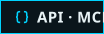
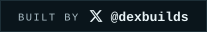
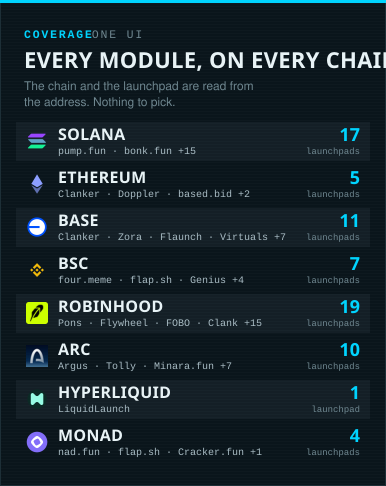
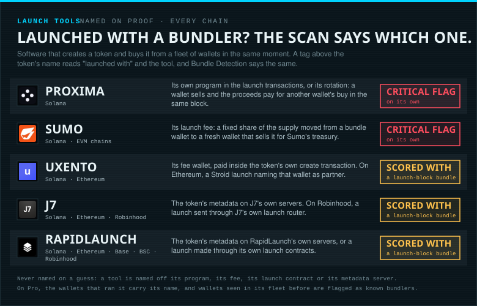
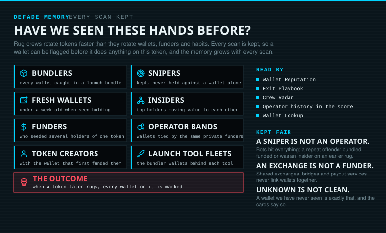
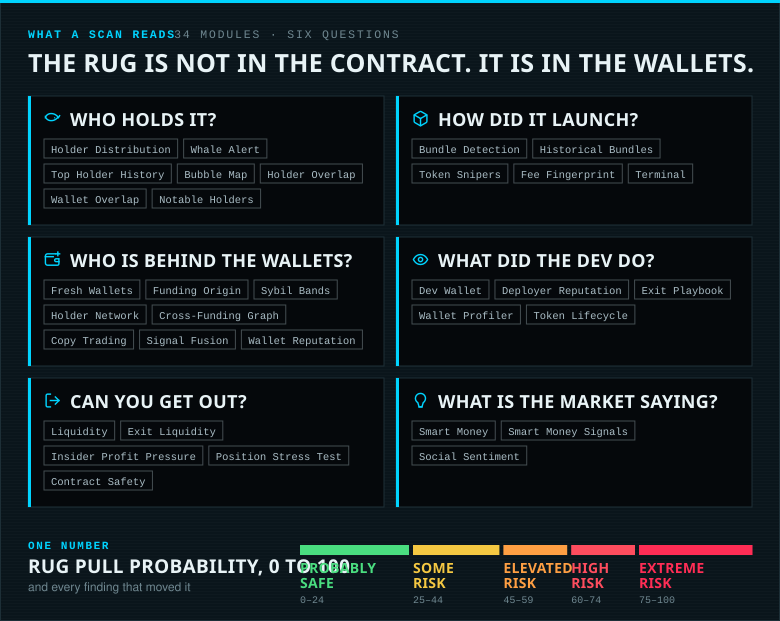

<a href="https://defade.org"></a>

<p align="center">
  <a href="https://defade.org"></a>
  <a href="https://t.me/DeFadeAnalyzerBot"></a>
  <a href="https://defade.org/download"></a>
  <a href="https://chromewebstore.google.com/detail/defade-%E2%80%94-solana-rug-pull/omcpnfjfaedbkakmnmbfjfmdnbpninof"></a>
  <a href="https://defade.org/api-docs"></a>
</p>

<p align="center">
  <a href="https://x.com/dexbuilds"></a>
</p>

<a href="https://defade.org/survival"></a>

<a href="https://defade.org/heatmap"></a>
<a href="https://defade.org/whitepaper"></a>

<a href="https://defade.org/modules#launchpads"></a>

<a href="https://defade.org/modules#launch-tools"></a>

<a href="https://defade.org/blog/defade-memory"></a>

<a href="https://defade.org/modules"></a>

### Build on DEFADE

```js
import DeFade from 'defade';                      // npm install defade

const client = new DeFade({ apiKey: process.env.DEFADE_API_KEY });
const risk = await client.rugScore('TOKEN_MINT');  // 0 to 100
```

- **[REST API](https://defade.org/api-docs)**: 30 endpoints, every chain on every plan. A free 7-day trial key opens six of them.
- **[MCP connector](https://defade.org/api-docs#mcp)**: real DEFADE scans inside an AI assistant, 15 read-only tools at `https://api.defade.org/mcp`
- **[defade-sdk](https://github.com/DeFadeLtd/defade-sdk)**: the JavaScript client. Zero dependencies, Node 18+, CJS and ESM, TypeScript types.
- **[DeFade-scanner](https://github.com/DeFadeLtd/DeFade-scanner)**: how the scan and the score work, worked API examples, and where to report a wrong verdict.

<p align="center"><sub>The live cards redraw every day from <a href="https://defade.org/survival">defade.org/survival</a> and <a href="https://defade.org/heatmap">defade.org/heatmap</a>. DEFADE Ltd, London · <a href="mailto:info@defade.org">info@defade.org</a></sub></p>
